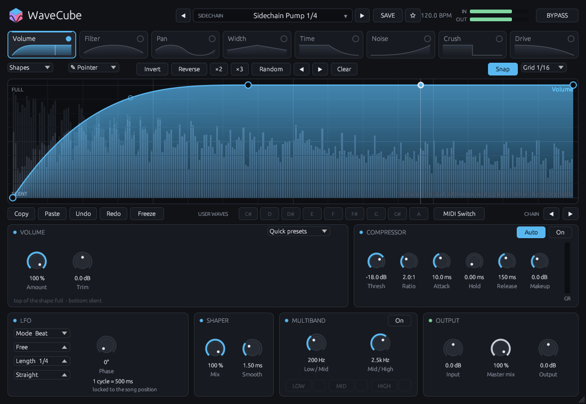
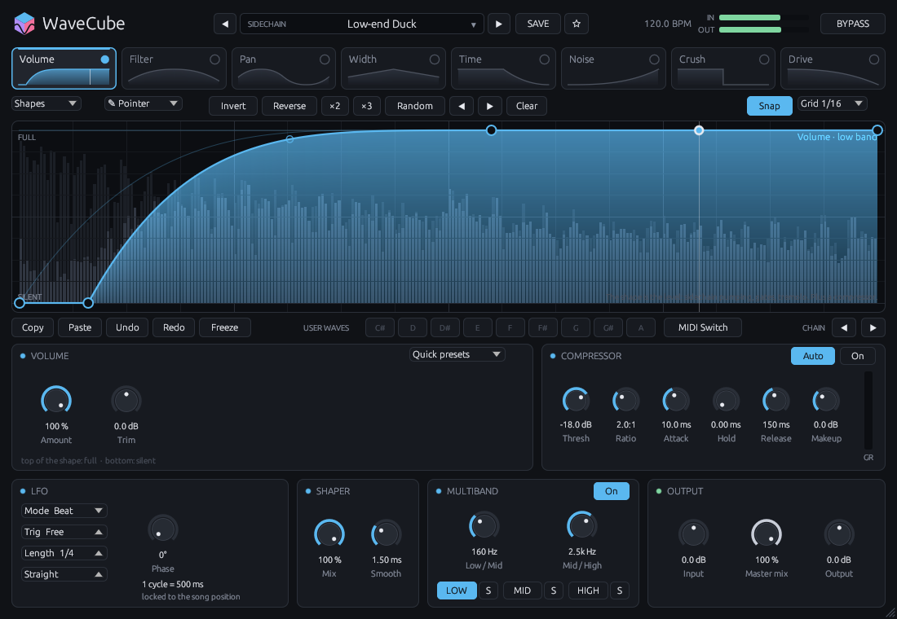

<div align="center">

# WaveCube

Draw a shape and let volume, filter, pan, width, time, noise, crush and drive follow it in time with your song.

[](https://github.com/xslimakx/WaveCube/actions/workflows/build.yml)
[](LICENSE)


[**Download**](https://github.com/xslimakx/WaveCube/releases/latest)

</div>

---

<p align="center"></p>

Eight shapers in one chain you can reorder. Each one has its own drawn LFO shape, its own timing, an envelope follower (Volume: a compressor) and, if you want, three bands with a shape and settings for each. Sidechain pumping without a sidechain, gates, wobbles, phasers, auto-pan, Haas swirls, mono bass, tape stops, half-time, scratches, risers, vinyl, bit crush and fold distortion.

## Shapers

| | Top / bottom of the shape | Controls |
|---|---|---|
| **Volume** | full / silent | Amount, Trim; **compressor**: Threshold, Ratio (to ∞:1), Attack, Hold, Release, Makeup + Auto |
| **Filter** | High / Low cutoff | LP / HP 6, 12, 24 dB, BP, Notch, Peak, **phasers** with 2-8 notches or peaks; Low, High, Resonance, Stereo (±60 st) |
| **Pan** | left / right | Balance 0 / 3 / 4.5 / 6 dB or Combined, Pan / Haas blend, Haas range 0-40 ms |
| **Width** | twice as wide / mono | Amount, Gain |
| **Time** | now / late | Range: one cycle, 1-8 bars, or 2.5 / 10 / 20 ms; slopes bend the pitch |
| **Noise** | loud / off | White, Pink, Brown, Vinyl crackle, Digital, Mains hum, Air, Tape hiss; High-pass, Low-pass, Stereo, Follow / Duck, Noise only |
| **Crush** | crushed / clean | Crunch (wave wrap), Push, Bits (16-1), Dither, Resample (44.1 kHz - 8.8 Hz), Jitter, Anti-alias, Low-pass, Gain |
| **Drive** | driven / clean | 10 styles (soft / hard clip, square, rectify, skew / sine / triangle / extreme fold), Input, Output, Push, Grip, Accent, Tone |

Every shaper: **on / off** (the dot on its tab), **Mix**, **Smooth**, **Multiband** (two splits, a shape per band, **S** = solo), **Quick presets** (Init + three ready setups). Filter, Pan, Width, Noise, Crush and Drive have an **envelope follower** (Amount ±200 %, Attack, Hold, Release, Threshold; Filter / Width: Add or Multiply).

## The shape editor

- **Pointer**: drag points; drag on empty space or double-click for a new one; double-click / right-click deletes; drag the small rings to bend a segment.
- **Pens**: Step, Ramp up, Ramp down, Arc, S-curve, Triangle: click or drag over the grid cells, the height is where you click.
- **Shapes** menu (20 shapes), **Invert**, **Reverse**, **×2**, **×3**, **Random** (Shift: keep the points), **◀ ▶** move by a grid step, **Clear**, **Copy / Paste** between shapers and bands, **Undo / Redo** (Ctrl+Z / Ctrl+Shift+Z).
- **Grid** 1/4 … 1/64 and triplet grids, **Snap** (Shift toggles it while dragging). The pointer position is shown in steps and %.
- Behind the shape: one cycle of the audio, input dark and output light; **Freeze** holds it.
- **User waves**: nine slots. Click an empty slot to store the shape, click a full one to load it back (Shift-click: overwrite, right-click: clear). With **MIDI Switch** on, MIDI notes C# to A load the slots into their shapers while playing; only C notes restart the LFOs then.

<p align="center"> </p>

## LFO

**Mode**: Beat (tempo and song position), Hz (0.02 Hz - 5 kHz), Pitch (speed = the MIDI note played). **Trigger**: Free, MIDI, MIDI 1-shot, Audio, Audio 1-shot (1-shot plays once and holds the end). **Length** 1/128 to 32 bars, straight / dotted / triplet, **Phase**.

## Presets

Click the preset name for the browser: search, All / Favourites / Factory / User and nine categories, the shapers each preset uses, ★ to mark favourites, ✕ to delete your own. **◀ ▶** step through the current list, **SAVE** stores the whole plugin (every control, all shapes, user waves). 38 factory presets. User presets are JSON files in:

| OS | Folder |
|---|---|
| Linux | `~/.local/share/WaveCube/Presets` |
| Windows | `%APPDATA%\WaveCube\Presets` |
| macOS | `~/Library/Application Support/WaveCube/Presets` |

<p align="center"></p>

## How it works

```
input → Input → shaper → shaper → … (your order) → Master mix → Output
shaper: LFO (song position / Hz / note pitch; restarted by MIDI or audio hits; 1-shot)
        → drawn shape (2048-point table) → Smooth → + envelope follower
        → full band, or Linkwitz-Riley 24 dB/oct split into 3 bands (flat sum, solo)
        → effect per band → shaper Mix
```

No latency.

## Tested

`cargo test -p wavecube` (35 tests): everything off is bit-exact, neutral shapes are transparent; Volume follows the shape; the compressor reduces by the ratio; the three bands sum flat within 0.1 dB, solo plays one band; every filter type closes / opens where it should; the envelope opens the filter; Time delays by exactly the drawn amount; Pan and Haas; every noise type; every drive style stays bounded; MIDI restarts, 1-shot holds, Pitch mode runs at the note, MIDI Switch loads user waves; Beat mode lands on the song position; all factory and quick presets are valid and survive a save / load; fuzzing every mode at extreme settings never blows up. All 8 shapers × 3 bands with everything on: about 10 % of one core.

## Installation

Download the archive for your OS from [Releases](https://github.com/xslimakx/WaveCube/releases/latest), unzip it and copy `WaveCube.vst3` into your VST3 folder:

| OS | Path |
|---|---|
| Linux | `~/.vst3/` or `/usr/lib/vst3/` |
| Windows | `C:\Program Files\Common Files\VST3\` |
| macOS | `~/Library/Audio/Plug-Ins/VST3/` |

## Building from source

Needs [Rust](https://rustup.rs/) (stable). Linux: `libasound2-dev libgl-dev libx11-xcb-dev libxcb1-dev libxcb-icccm4-dev libxcursor-dev libxkbcommon-dev libxcb-dri2-0-dev`.

```bash
git clone https://github.com/xslimakx/WaveCube.git
cd WaveCube
cargo xtask bundle -p wavecube --release   # -> target/bundled/WaveCube.vst3
cargo run --release -p wavecube --features standalone   # standalone test app
```

## License

[MIT](LICENSE). Note: compiled `.vst3` builds link GPLv3 `vst3-sys` bindings (via NIH-plug), so GPLv3 terms apply when you distribute compiled binaries. Crates in `vendor/` keep their own licenses.
