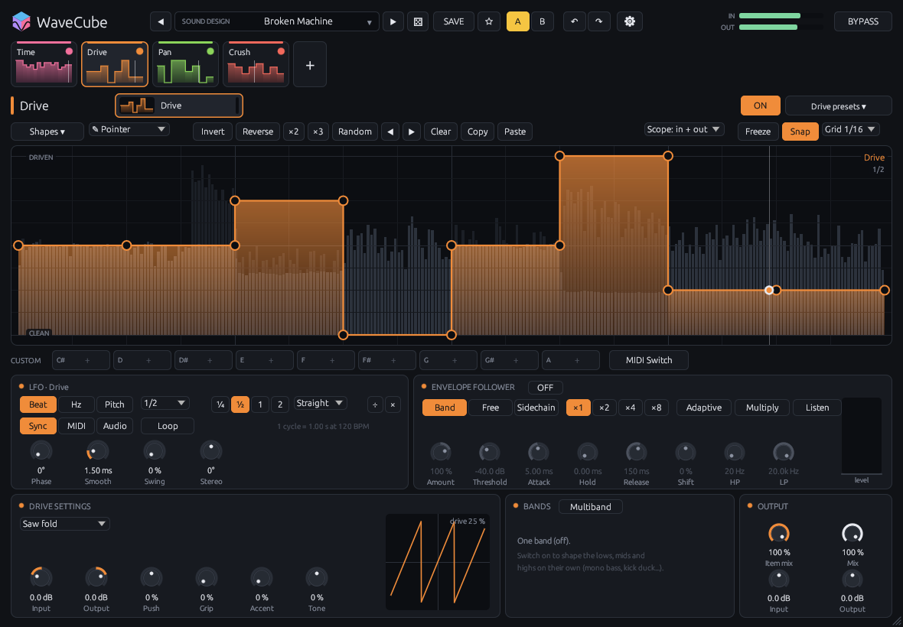
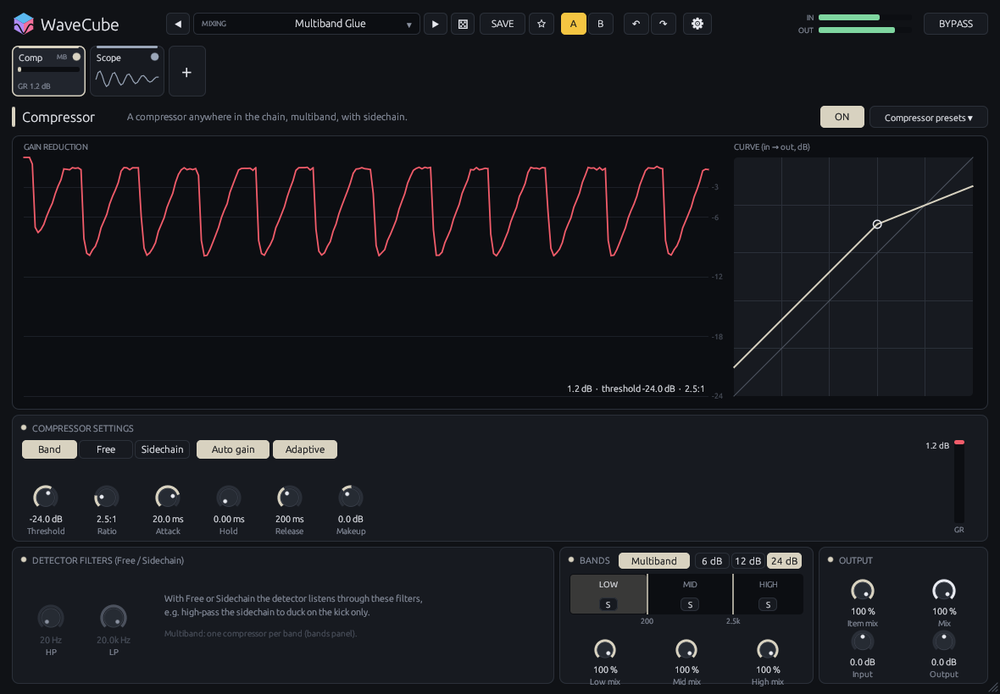
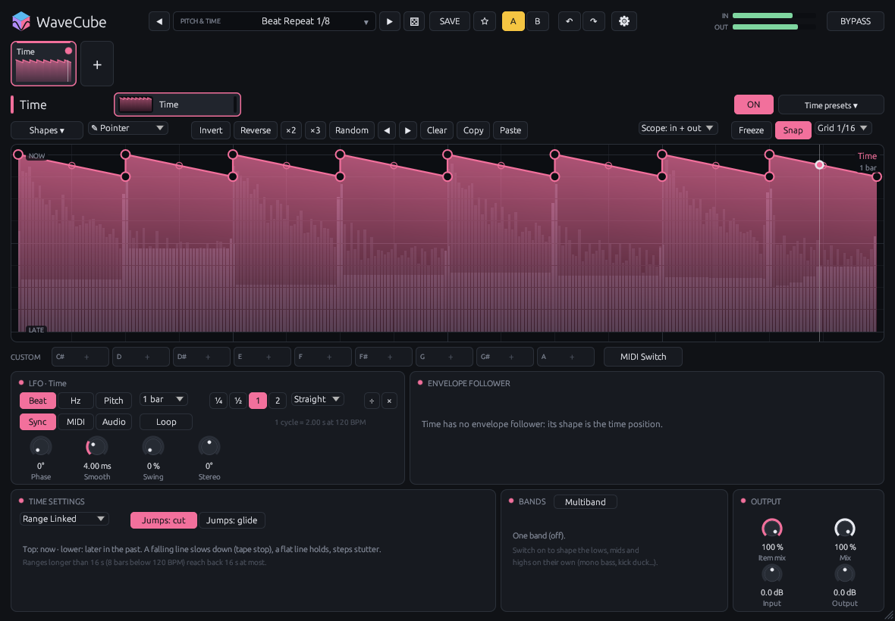
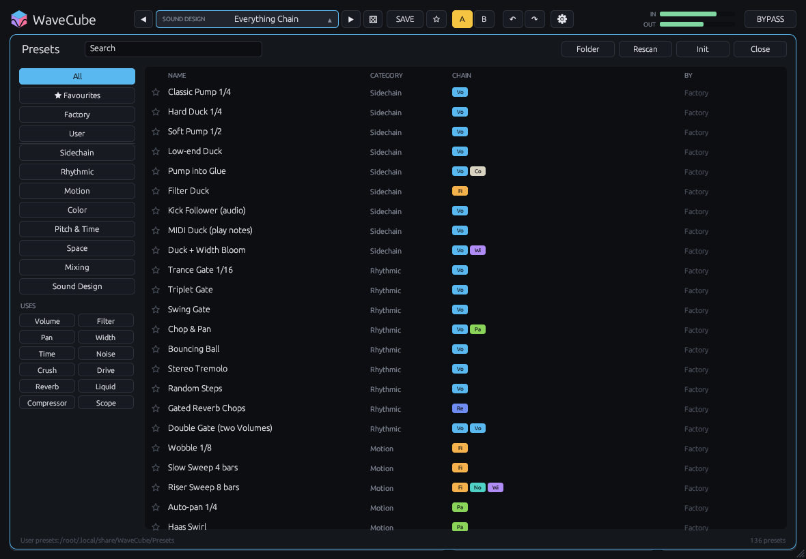
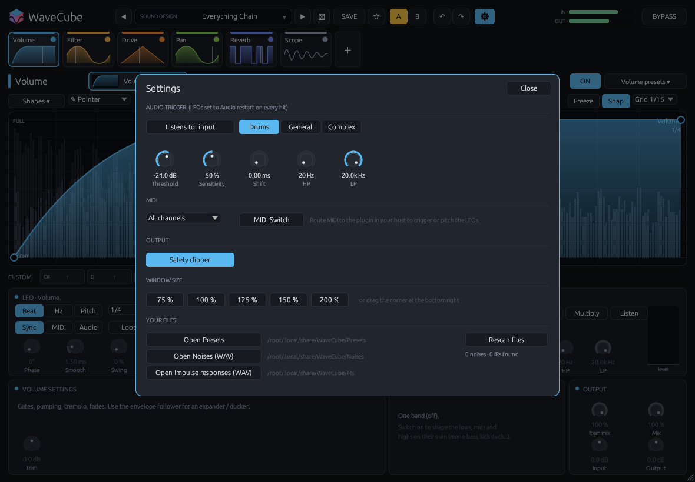

<div align="center">

# WaveCube

A modular shaper: build a chain of up to 12 items (volume, filter, pan, width, time, noise, crush, drive, reverb, liquid, compressor, scope), draw their shapes, and let them move in time with your song.

[](https://github.com/xslimakx/WaveCube/actions/workflows/build.yml)
[](LICENSE)


[**Download**](https://github.com/xslimakx/WaveCube/releases/latest)

</div>

---

<p align="center"></p>

## The chain

- **Up to 12 items, any kind, any order, the same kind as often as you like** (two Drives, three Volumes...). **+** adds one (Shift: right after the selected one), drag a tile to move it, **×** removes it, the dot switches it on / off.
- **Right-click a tile**: Duplicate, Replace with another kind, Add after, Copy / Paste item, Reset, Remove.
- Every item has its own **presets** (factory and your own), its **Mix**, and **Multiband**: three bands with their own shapes, LFO, envelope, mix and solo; splits dragged in the band picture, 6 / 12 / 24 dB, the bands always add up flat.

<p align="center"> </p>

| Item | Shapes (lanes) | Settings |
|---|---|---|
| **Volume** | Volume | Trim |
| **Filter** | Cutoff, Resonance | Low-pass, High-pass, Band-pass, Notch, Peak; 6 / 12 / 24 dB; Clean or Warm (Dist, Safe res, Hard dist); Stereo ±60 st; Output; live response curve |
| **Pan** | Pan | Balance 0 / 3 / 4.5 / 6 dB or Combined; Pan / Haas blend, Haas range; vectorscope |
| **Width** | Width (mono … twice as wide) | Gain; vectorscope |
| **Time** | Time position | Range: one cycle, 1 / 2 / 4 / 8 bars, 2.5 / 10 / 20 ms; jumps **cut** (clean cross-fade) or **glide** (scratch) |
| **Noise** | Volume, Pitch (±24 st) | 24 noises (colours, rain, wind, ocean, fire, tape, vinyl, hum, radio, cymbals, shaker, snare wires…) **+ your own WAV files**; HP, LP, Stereo, Mono, Follow / Duck, Noise only |
| **Crush** | Bits, Resample | Crunch (wave wrap), Push, Jitter, Treble, Gain, Dither, Anti-alias |
| **Drive** | Drive | 12 styles (soft / smooth / hard clip, squares, rectifiers, skew / sine / triangle / saw / extreme fold); Input, Output, Push, Grip, Accent, Tone; transfer curve |
| **Reverb** | Send, Volume | 14 spaces (halls, rooms, chamber, plates, cathedral, endless, shimmer, modulated, spring, metal tank, gated) **+ your own impulse responses**; Pre-delay, Decay, Size, Width, Tone, Dry, Wet; Gated, Clear tails |
| **Liquid** | Centre, Feedback | Flanger or phaser (2-8 stages), Negative; Stereo, Spread |
| **Compressor** (tool) | – | Threshold, Ratio (to ∞:1), Attack, Hold, Release, Makeup, Auto gain, Adaptive; listens to its band, the full input with filters, or the sidechain; multiband; gain reduction graph and curve |
| **Scope** (tool) | – | The signal at that point of the chain, synced to the tempo, L / R split |

<p align="center"></p>

## Shapes

- **Lanes**: items with two parameters have two shapes. Click a lane to edit it, **drag it up / down to offset** the whole shape (automatable).
- **Pointer** (points, bend rings), **Select** (box-select, move together, delete), **Pens**: Step, Ramp up / down, Arc, S-curve, Triangle.
- **Shapes** menu by category for each kind, **Invert, Reverse, ×2, ×3, Random** (Shift: keep the points), **◀ ▶**, **Clear, Copy / Paste** (between lanes, bands and items), **To all bands**.
- **Grid** 1/4 … 1/64 with triplets, **Snap** (Shift toggles), position read-out.
- Behind the shape: the item's input and output over one cycle (or output only, or off), **Freeze**.
- **Custom waves**: nine slots; **MIDI Switch** loads them while playing with notes C# … A, C triggers.
- **Undo / Redo** of everything (chain, settings, shapes): ↶ ↷ or Ctrl+Z / Ctrl+Shift+Z.

## LFO (per lane, per band)

**Beat** (song position; 32 bars … 1/128, straight / dotted / triplet), **Hz** (0.02 Hz … 5 kHz) or **Pitch** (the MIDI note, ±36 st). **Sync**, **MIDI** or **Audio** trigger (input or sidechain; Drums / General / Complex, threshold, sensitivity, shift, filters in ⚙). **Loop** or **1-shot** with a draggable END marker. **Phase, Smooth, Swing, Stereo** (right channel offset). In multiband the bands are linked (shared timing) or free. **→ other lane** copies the settings.

## Envelope follower (per lane, per band)

Listens to the band, the full input through its own HP / LP, or the **sidechain**. Amount ±200 %, Depth ×1 … ×8, Threshold, Attack, Hold, Release, Shift, Adaptive release, Add or Multiply, **Listen** to the detector, level graph.

<p align="center"></p>

## Presets

**136 factory presets** in Sidechain, Rhythmic, Motion, Color, Pitch & Time, Space, Mixing and Sound Design, plus 64 item presets. Browser with search, favourites, categories and a **Uses** filter (presets with a Reverb, a Compressor…), the chain of each preset as coloured tags, **◀ ▶**, **⚄** random preset, **A / B**, SAVE (everything) and item presets (one item). ⚙ also opens the folders.

<p align="center"> </p>

| OS | Presets | Your noises / IRs |
|---|---|---|
| Linux | `~/.local/share/WaveCube/Presets` | `~/.local/share/WaveCube/Noises`, `…/IRs` |
| Windows | `%APPDATA%\WaveCube\Presets` | `%APPDATA%\WaveCube\Noises`, `…\IRs` |
| macOS | `~/Library/Application Support/WaveCube/Presets` | `…/WaveCube/Noises`, `…/IRs` |

## Sound

- No latency (a user impulse response adds its own 256 samples to the reverb tail only).
- **No clicks**: switching items on / off, knobs, mix, offsets, new shapes, and changes of the chain or an item's type, slope or bands are faded; Time jumps cross-fade; delay lines fill before an item is heard.
- Works the same at 22.05 … 192 kHz and any block size; no DC; safe at any tempo; a safety clipper at the end (⚙).
- The plugin has a stereo **sidechain** input.

## Tested

`cargo test -p wavecube` (64 tests), including: every factory preset at 22.05 / 44.1 / 48 / 96 / 192 kHz (same level everywhere, finite, bounded), block sizes 1 … 2048 sound the same, no clicks on any kind of change for every item, silence after music stays cheap (no denormals) and dies away, tempo 20 … 999 BPM with the song position jumping, Hz and pitch at the ends of their ranges, no DC, mono hosts, Time reaches 16 s back, 1-shot holds cleanly in sync, bands sum flat at every slope, every filter / drive / noise / reverb type, the triggers and MIDI Switch, fuzzing everything at once.

CPU (one core, 48 kHz): one Volume about 0.3 %; 12 items × 3 bands with envelopes on about 25-30 %.

## Installation

Download the archive for your OS from [Releases](https://github.com/xslimakx/WaveCube/releases/latest), unzip it and copy `WaveCube.vst3` into your VST3 folder:

| OS | Path |
|---|---|
| Linux | `~/.vst3/` or `/usr/lib/vst3/` |
| Windows | `C:\Program Files\Common Files\VST3\` |
| macOS | `~/Library/Audio/Plug-Ins/VST3/` |

## Building from source

Needs [Rust](https://rustup.rs/) (stable). Linux: `libasound2-dev libgl-dev libx11-xcb-dev libxcb1-dev libxcb-icccm4-dev libxcursor-dev libxkbcommon-dev libxcb-dri2-0-dev`.

```bash
git clone https://github.com/xslimakx/WaveCube.git
cd WaveCube
cargo xtask bundle -p wavecube --release   # -> target/bundled/WaveCube.vst3
cargo run --release -p wavecube --features standalone   # standalone test app
```

## License

[MIT](LICENSE). Note: compiled `.vst3` builds link GPLv3 `vst3-sys` bindings (via NIH-plug), so GPLv3 terms apply when you distribute compiled binaries. Crates in `vendor/` keep their own licenses.
